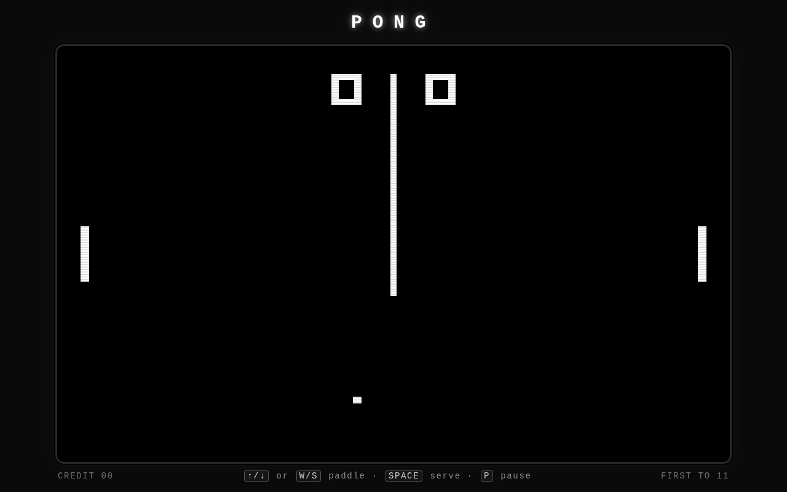

# Snart Pong

The classic 1972 arcade game, faithful to the original — played in the browser
against the CPU, in a cabinet that looks like the machine and sounds like it.

## What is kept faithful

- **Monochrome play.** White on black, a square ball, square paddles — no
  colour, no gradients, no easing.
- **First to 11 wins a game**, then sides swap, as in the cabinet.
- **The serve goes toward the player who just lost**, giving them the first
  touch.
- **Edge angle.** The ball leaves the paddle at an angle set by where it hit;
  an edge hit goes sharper.
- **It speeds up.** The ball gets a little faster on every paddle hit, like
  the original, and the paddle is faster than the ball.
- **The blip sounds** are square-wave beeps: paddle hit, wall bounce, point.

## Play

- **↑ / ↓** or **W / S** move your paddle.
- **Space** starts the game; **P** pauses.
- Beat the CPU to 11 to win, then sides swap for the next game.
- Your high score and sound preference are kept locally (offline, in the
  service-worker cache and `localStorage`).

## Install (PWA)

The app is installable on Android, iOS and desktop:

- **Android / Chrome** — *Add to Home screen* → **Install**.
- **iOS / Safari** — *Share* → **Add to Home Screen**.
- **Desktop** — Chrome/Edge install icon in the address bar.

It is fully offline once loaded: the service worker precaches every asset the
page uses, and navigation requests fall back to the cache.

## Build & test

Everything is plain HTML/CSS/JS — no build step, no bundler, no framework. The
only external tooling is Playwright (for the browser test and the screenshot
generator); it is **not** a runtime dependency.

| Test | Command | What it pins |
| --- | --- | --- |
| Core physics | `node test/pong.js` | Serve, bounce, speed gain/cap, scoring, first-to-11, side swap, no tunneling |
| Static PWA | `node test/pwa.js` | Manifest/worker/page agree; every precache URL exists; sizes match the PNGs on disk |
| Browser | `NODE_PATH=~/.hermes/hermes-agent/node_modules node test/browser.js` | Loads clean, worker precaches, ball moves, boots offline from cache |

Regenerate the assets (not needed unless you change the design):

- `python3 tools/make-icons.py` — all icon sizes + maskable + Apple touch icon.
- `NODE_PATH=~/.hermes/hermes-agent/node_modules node tools/make-shots.js` — the two
  `screenshots/*.png` declared in `manifest.json`, by actually playing the game.

## Deploy

Static files. The production home is <https://snart.com/pong>.

## License

AGPL-3.0-or-later — see [LICENSE](LICENSE).
